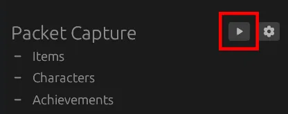
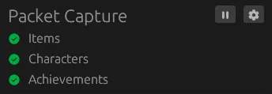

# Quickstart

## Download Irminsul

The latest Irminsul release can always be found on the [Irminsul GitHub Releases Page](https://github.com/tawan475/irminsul/releases). Grab the file for your platform, not either of the "Source code" archives:

| File | Platform | Capture backend |
| --- | --- | --- |
| `irminsul-windows.exe` | Windows x64 | `pktmon` (built into Windows, nothing to install) |
| `irminsul-windows-pcap.exe` | Windows x64 | `pcap`, requires the Npcap runtime |
| `irminsul-linux-x86_64.tar.gz` | Linux x86_64 | `pcap`, libpcap is statically linked in |
| `Irminsul-macos-arm64.app.tar.gz` | macOS (Apple Silicon) | `pcap` |

If you are on Windows and unsure which one to take, take `irminsul-windows.exe`: it needs no driver install.

## Install a Pcap library (only for the pcap backend)

- **Windows**: only needed for `irminsul-windows-pcap.exe`. Install Npcap (<https://npcap.com/#download>). The older WinPcap should work too, but we didn't test it. `irminsul-windows.exe` uses `pktmon` and needs nothing.
- **Linux**: nothing to install. The released binary has libpcap linked into it. You only need libpcap from your distro's package manager if you build Irminsul yourself.
- **macOS**: nothing to install; libpcap ships with the system.

## Unpack the download

**Windows**: the download is the executable itself, nothing to unpack.

**Linux**: extract the tarball, which contains a single `irminsul` binary.

```
tar -xzf irminsul-linux-x86_64.tar.gz
chmod +x irminsul
```

**macOS**: extract the tarball, which contains `Irminsul.app`. The app is not
notarized, so macOS quarantines it after download; clear that flag before
launching it:

```
tar -xzf Irminsul-macos-arm64.app.tar.gz
xattr -dr com.apple.quarantine Irminsul.app
```

## Launch Irminsul and grant it packet capture privileges

Irminsul needs to be running and capturing packets before you enter the door into the main game. The simplest way to accomplish this is to launch Irminsul before launching Genshin

Irminsul needs admin/root privileges to observe Genshin's network traffic and won't work without it.

On Windows, accept the admin prompt that appears when Irminsul starts.

On Linux, you can either grant the extracted binary permission to capture packets:

```
sudo setcap cap_net_raw=ep ./irminsul
```

or run it as root every time:

```
sudo ./irminsul
```

`setcap` grants the permission to that particular copy of the file, so it has to be re-run after every update. Irminsul tells you when this is needed and shows you the command to use.

On macOS, open `Irminsul.app`. Its launcher checks whether it can read `/dev/bpf0` and, if it can't, asks for an admin password once to run `chmod 644 /dev/bpf*`. macOS resets those permissions on reboot, so expect the prompt again after restarting.

## Start packet capture

Click on the play button in the "Packet Capture" section. This will start Irminsul capturing packets.



## Start Genshin and enter the door

Once packet capture is running, enter the door in Genshin


Once Irminsul detects the various data it needs, you'll green checkmarks appear in the "Packet Capture" section.



## Export data


Once the data has been captured, you can export:

- To the clipboard by clicking ont the clipboard with the arrow icon.
- To a file by clicking on the download icon.

Which data gets exported can be controlled by clicking on the settings icon.
These settings shape the Genshin Optimizer exports (clipboard, file and the
automation file) only; a tracker upload always carries the whole account.

## Upload to a Genshin Data Tracker

This fork can also push a capture straight to a Genshin Data Tracker account,
from the "Tracker" section of the main window. By default it talks to the hosted
tracker at <https://genshin-tracker.475.dev>:

1. Click **Sign in** in the "Tracker" section. Your browser opens the tracker:
   sign in there if you aren't already, choose where this PC's uploads go, and
   click **Allow**. The page then says you can close it, and Irminsul shows
   "Signed in as <your name>" and where uploads go.
2. With a capture completed, click the cloud upload icon to send the current
   data. Tick "Auto export to tracker" in the same section to upload every
   completed capture automatically.

Where uploads go is set on the tracker, not in Irminsul: **Auto (by UID)**
(the default) files each capture under the account with that capture's UID and
creates one for a new UID; **Always this account** sends everything to one
account. Click **Configure** next to "Uploads:" to change it in the browser;
Irminsul picks the change up when you come back to its window (and every few
minutes while it is open). This PC also appears in the tracker's **Settings →
Devices** as "Irminsul on <PC name>", where you can change the target or sign
it out.

The sign-out icon next to your name signs this PC out: it ends the session on
the tracker and deletes what Irminsul stored. Signing out everywhere on the
tracker, changing your password there, or signing this device out from its
Devices page signs Irminsul out too; it then says "Signed out, sign in again".

What is stored where: the sign-in's long-lived (refresh) token is kept in your
system's credential store -- Windows Credential Manager, the macOS Keychain, or
the Secret Service (GNOME Keyring, KWallet) on Linux -- under the name
`irminsul`, one entry per tracker address. It is never written to Irminsul's
settings file. The short-lived token uploads are sent with lives only in
memory. On a Linux desktop without a Secret Service, the sign-in lasts until
Irminsul closes (it says "Signed in for this session only").

If the browser that opens is not the one you use (Irminsul runs as
administrator on Windows, and a browser started from it can open as a separate,
signed-out window), finish the sign-in there, or click the copy icon next to
"Waiting for the browser…" and paste the link into the browser you normally
use. Cancel stops waiting.

An upload holds everything the capture saw -- every character, every artifact
and weapon of any rarity and level, all materials and achievements -- whatever
the Genshin Optimizer export settings leave out, and it never fakes an
artifact's fourth line. The toast names the counts it sent (for example
"1,122 weapons"), so you can hold them against the game's own.

### Advanced: tracker address and import key

The gear icon opens the tracker window. Under **Advanced**:

- **Tracker address**, so a self-hosted tracker needs no rebuild: enter your
  tracker's API base and click **Apply**. Irminsul asks "Uploads will now go to
  <host>. Continue?" first -- every upload carries the whole account, so a
  pasted lookalike address must not slip through -- and signs out of the old
  address: a sign-in belongs to one address and its tokens are never sent to
  another. The default is `https://genshin-tracker.475.dev/api`; note the
  `/api`, under which the tracker serves its API. The compile-time
  `TRACKER_API_URL` replaces that default for a build and only supplies the
  value a fresh install starts with; once you have changed the address the
  stored one wins, including after an update to a build with a different
  baked-in default. The exceptions are an empty address and the old default
  `http://localhost:49000`, which Irminsul resets to the build's default when
  it starts (to keep using a local backend on that port, enter it as
  `http://127.0.0.1:49000`). The reset icon next to the field puts the build's
  own value back in the field.
- **Import key**, the older way to link an account, which keeps working for as
  long as you are not signed in: generate an **Import Key** in the tracker
  dashboard, paste it here and click "Save & Close"; Irminsul verifies it and
  shows the account name, UID and server it belongs to. Once you sign in, the
  key is no longer used. The key is stored in plain text with the rest of
  Irminsul's saved state on your machine and never expires, which is why
  signing in is the recommended way; "Clear key" removes it.

## Wish history

Irminsul reads your wish history with the game's own wish key. A key lasts
about a day, and it comes from one of two places:

- **The game**: whenever the game opens its wish history page, the server
  sends it a key, and Irminsul picks it up from the traffic while it is
  decrypting the session.
- **The game's web cache**: that page leaves the game's own link, key
  included, in the game's web cache. Irminsul looks there when it starts,
  whenever the cache changes, and when you click Copy wish URL without a key.
  It finds the game's folder in the game's log, takes the newest wish link
  from the cache and checks it with one request to the game's wish history
  server; a link that has expired is ignored. So the wishes of a day sync even
  when Irminsul was not running, or not decrypting, when the page opened.

A key from the traffic always wins over one from the cache, and the same key
is never synced twice. The "Wish History" section says what is the case:
"Key valid ~20 h · from the game" or "· from the cache"; "No wish key yet";
or "Waiting for the game's login" while Irminsul cannot read the game (for
example when the game was started before Irminsul) and has no key. Hover the
line for details, including what Irminsul has seen this session: the banner
list (the Wish screen), a wish key from the game, the client version, the UID
and the cached link (none, found, valid, expired or refused). If something
stays missing, the same discoveries are in the log ("Open log folder",
`latest.log`); it never holds the key or the URL.

- **Copy wish URL** (the clipboard icon) copies the game's own wish URL for
  that key (a link from the cache exactly as the game wrote it). Paste it into
  [paimon.moe](https://paimon.moe/wish/import) ("Manual" import) or
  [StarDB](https://stardb.gg/en/genshin/wish-import); the "Open Paimon.moe"
  and "Open StarDB" links copy it and open the page in one go.
- **Sync to the tracker**: when Irminsul uploads to a Genshin Data Tracker by
  itself -- signed in (or with a verified import key) and "Auto export to
  tracker" ticked -- a new key also sends your wish history there. It asks the
  tracker which wishes it already has, then reads only the newest page of each
  banner and goes further back only while the wishes are new, at a gentle pace
  (a second between pages). A wish you make in game sends that banner's new
  wishes about 20 seconds later. Nothing is fetched otherwise. The section shows
  the last sync ("Synced 21:04 · added 37") or why it did not happen (for
  example "the upload target no longer exists; choose one with Configure on
  the tracker").

The key works like a password for your wish history while it lasts: Irminsul
keeps it in memory only, never writes it to its log or settings, and sends it
only to the game's own wish history server -- never to the tracker, which
only receives the wishes themselves.

## Start Irminsul when you sign in (Windows)

Tick "Start Irminsul on startup" in the "Automation" section. Irminsul then
registers a Task Scheduler task named `Irminsul` that starts this copy about 15
seconds after you sign in, with the administrator rights packet capture needs
and without a UAC prompt. Untick it to remove the task. (Older versions used the
ordinary startup list, which Windows never runs for a program that needs
administrator rights; a newer version moves that entry to the task when it
starts.)

If the task starts a different copy of Irminsul, or a file that is no longer
there, an amber warning icon appears next to the checkbox. Click it to see both
paths, and "Start this copy instead" to point the task at the copy you are
running.

## Memory use

Most of what an open Irminsul window holds belongs to the graphics driver and
the window itself, not to the capture: on Windows typically 50 to 150 MB in
Task Manager's "Memory" column, depending on the graphics driver, against some
15 MB for capturing and decoding a whole account. Minimize Irminsul, to the tray or the taskbar, while
you play: within a couple of seconds it hands the window's share back to
Windows, and the column drops to the capture's few MB. It comes back when you
open the window again. ("Commit size" stays higher, since the driver keeps its
reservation until Irminsul exits.)

## Command line options

Irminsul also supports a couple of command line flags when launching from a terminal:

- `--capture-backend <pktmon|pcap>` (or `-b`): on Windows you can choose between the `pktmon` backend (default) and the cross-platform `pcap` backend. On other platforms only `pcap` is available.
- `--no-admin`: on Linux and macOS, skip the packet-capture privilege check and the "permissions missing" dialog it would otherwise show; capture itself still needs root/`CAP_NET_RAW`/`/dev/bpf` access. On Windows the flag does nothing: the executable carries a manifest requesting administrator rights, so Windows shows the UAC prompt and decides elevation before Irminsul's own code runs.
- `--read-from-file` (or `-r`): replay a previously saved capture file instead of capturing live traffic. The file is passed as a positional argument, e.g. `irminsul -r capture.pcapng`. Replay needs no admin/root rights, but it only works with the `pcap` backend, so on Windows use `irminsul-windows-pcap.exe -b pcap -r capture.pcapng`. This is mostly useful for debugging.
- A positional file path *without* `--read-from-file` records the live capture (pcap backend only). It is a filename template rather than an output path: Irminsul captures on every eligible network interface at once and gives each one its own file named after the device, so `irminsul -b pcap session.pcap` produces one `session-<interface>.pcap` per interface and no plain `session.pcap`. The log names each file as it is opened.
